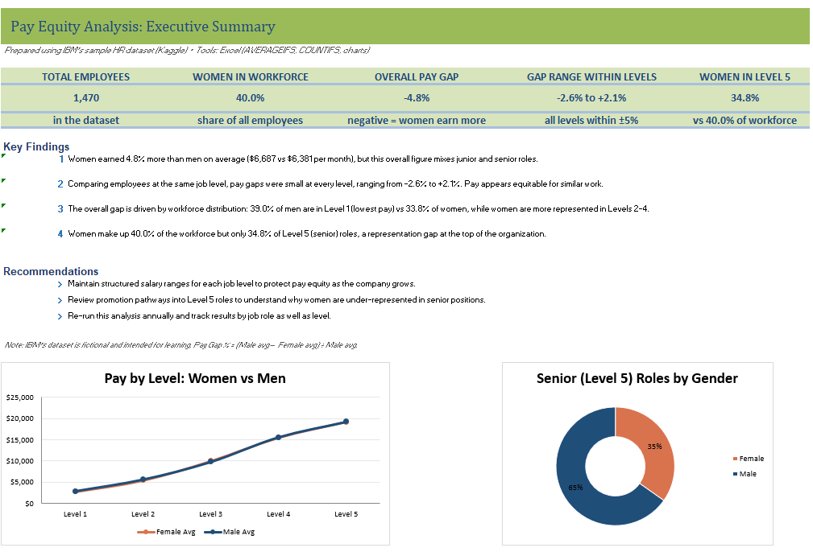
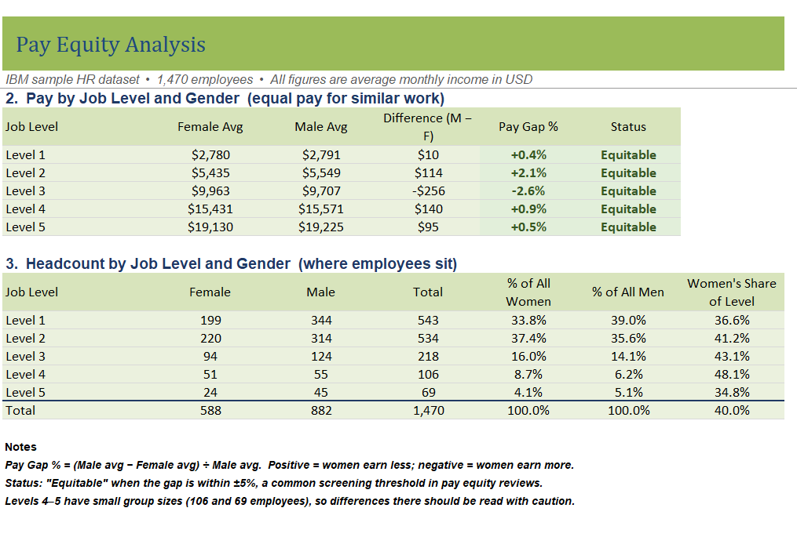
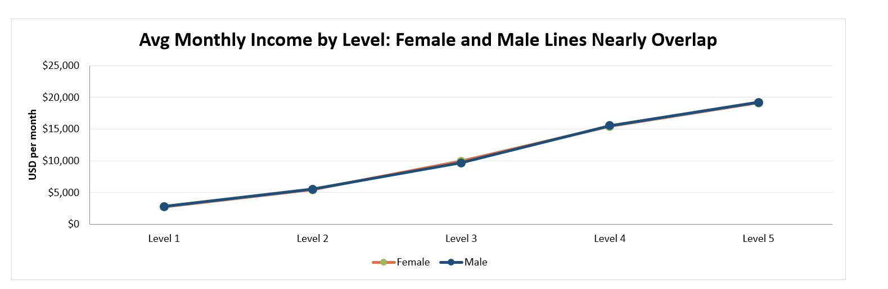

# HR Pay Equity Analysis (Excel)

## Objective
Assess whether men and women are paid fairly for similar work, using IBM's sample HR dataset of 1,470 employees.

## Tools Used
Excel: AVERAGEIFS, COUNTIFS, pivot tables, conditional formatting, charts

## Executive Summary

## Key Findings
1. **Overall:** Women earned 4.8% more than men on average ($6,687 vs. $6,381 per month).
2. **Within job levels:** Pay gaps were small at every level (−2.6% to +2.1%), indicating pay is equitable for similar work.
3. **Why the overall gap exists:** 39.0% of men are in Level 1 (lowest pay) vs. 33.8% of women, while women are more represented in Levels 2–4.
4. **Senior representation:** Women are 40.0% of the workforce but only 34.8% of Level 5 roles.

## Recommendations
- Maintain structured salary ranges for each job level.
- Review promotion pathways into senior (Level 5) roles.
- Re-run this analysis annually, including by job role.

## Method
Pay Gap % = (Male avg − Female avg) ÷ Male avg. Gaps within ±5% are treated as equitable.

## Data
IBM HR Analytics Employee Attrition & Performance dataset (fictional sample data), from Kaggle.

## Files
- [Pay_Equity_Project.xlsx](Pay_Equity_Project.xlsx.xlsx): full analysis, charts, and data (click, then use the download button)
